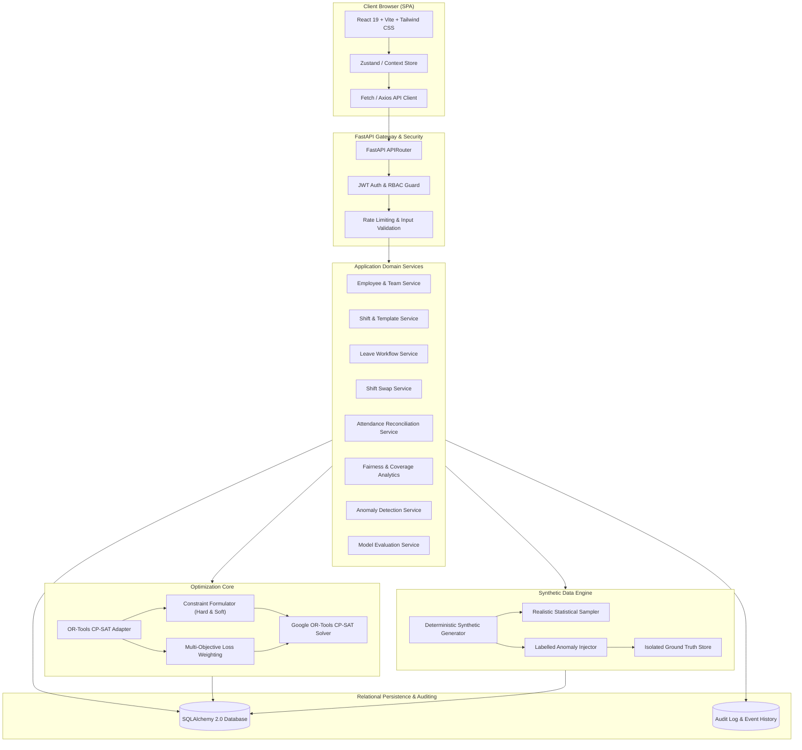
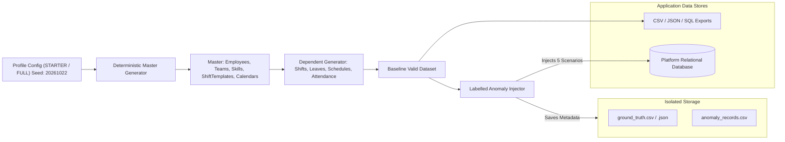
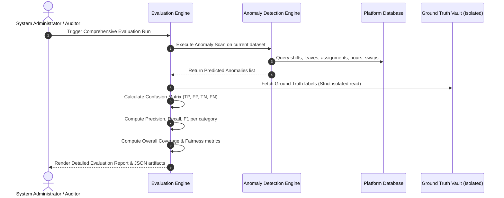

# System Architecture & Technical Design Document
## Intelligent Workforce Scheduling & Optimization Platform

**Document Version:** 1.0.0  
**Status:** Architecture Baseline Approved  
**Author:** Principal AI Systems & Software Architecture Team  

---

## 1. System High-Level Architecture

The platform is designed as a decoupled, modular service-oriented system comprising:
1. **Frontend Presentation Tier:** React 19 + TypeScript + Vite + Tailwind CSS + Lucide Icons + Recharts for interactive visualization.
2. **Backend Application & Domain Tier:** Python 3.13 + FastAPI with Pydantic validation, structured service layers, and transactional repositories.
3. **Constraint Optimization Core:** Google OR-Tools CP-SAT (Constraint Programming - Satisfiability) integer solver for workforce roster generation.
4. **Synthetic Data & Anomaly Engine:** Deterministic data generator, anomaly injector, and isolated ground-truth evaluator.
5. **Data Persistence Tier:** SQLite 3 (WAL mode) / PostgreSQL compatible relational engine managed via SQLAlchemy 2.0 ORM.
6. **Asynchronous Background Processing:** FastAPI background tasks and asynchronous job runner for long-running solver computations and dataset generation.

---

## 2. Solver Selection & Optimization Methodology

### 2.1 Justification for Google OR-Tools CP-SAT
For workforce shift scheduling problems (often formalized as the Nurse Rostering Problem - NRP or Multi-Skill Resource-Constrained Project Scheduling), exact constraint satisfaction with boolean and integer variables is mathematically superior to heuristic search or Large Language Models (LLMs):

1. **Guaranteed Hard Constraint Satisfaction:** CP-SAT enforces labor regulations (no overlapping shifts, mandatory 11-hour rest periods, maximum weekly hours) with mathematical certainty ($0.00\%$ violations). Heuristic or LLM-based schedules cannot guarantee zero labor law breaches.
2. **Global Optimality vs. Provable Bounds:** When a solution is found, CP-SAT provides the exact objective value and optimality gap, enabling transparent classification of results as `OPTIMAL` or `FEASIBLE` with provable bounds.
3. **Infeasibility Explainability:** When demand exceeds supply or constraints conflict, CP-SAT can identify conflicting constraints and uncovered slots rather than silently inventing invalid assignments.
4. **Performance & Scalability:** Modern CP-SAT leverages lazy clause generation and SAT search engines, solving hundred-employee multi-week rosters in seconds.

### 2.2 Mathematical Formulation

Let:
- $E$ be the set of active employees.
- $S$ be the set of dated shift instances requiring staffing.
- $K$ be the set of skills.
- $x_{e,s} \in \{0, 1\}$ be the binary decision variable: $x_{e,s} = 1$ if employee $e$ is assigned to shift $s$, else $0$.
- $u_s \ge 0$ be the slack integer variable representing unfilled staffing shortfall for shift $s$.

#### Hard Constraints:

1. **Staffing Requirement:**
   $$\sum_{e \in E_{s, k}} x_{e, s} + u_{s, k} = \text{Req}_{s, k} \quad \forall s \in S, k \in K$$
   where $E_{s, k}$ is the set of employees certified in skill $k$ eligible for shift $s$.

2. **No Overlapping Shifts (Double Booking):**
   $$\sum_{s \in \text{Overlapping}(s')} x_{e, s} \le 1 \quad \forall e \in E, \forall s' \in S$$

3. **Approved Leave Exclusion:**
   $$x_{e, s} = 0 \quad \forall e \in E, \forall s \in S \text{ such that } \text{ShiftDate}(s) \in \text{ApprovedLeave}(e)$$

4. **Minimum Rest Interval ($\Delta T_{\text{rest}} \ge 11 \text{ hours}$):**
   $$x_{e, s_1} + x_{e, s_2} \le 1 \quad \forall s_1, s_2 \in S \text{ where } 0 < \text{StartTime}(s_2) - \text{EndTime}(s_1) < \Delta T_{\text{rest}}$$

5. **Maximum Weekly Working Hours:**
   $$\sum_{s \in W_w} \text{Duration}(s) \cdot x_{e, s} \le \text{MaxHours}(e) \quad \forall e \in E, \forall \text{week } w$$

6. **Maximum Consecutive Working Days ($D_{\text{max}} = 6$):**
   $$\sum_{d = t}^{t + D_{\text{max}}} y_{e, d} \le D_{\text{max}} \quad \text{where } y_{e, d} = \bigvee_{s \in \text{ShiftsOnDay}(d)} x_{e, s}$$

#### Objective Function:
Minimize:
$$\mathcal{Z} = W_{\text{unfilled}} \sum_{s, k} u_{s, k} + W_{\text{overtime}} \sum_{e, w} \text{OT}_{e, w} + W_{\text{fairness}} \sum_{e} \text{Dev}_{e} + W_{\text{night}} \sum_{e} \text{NightDev}_{e} - W_{\text{pref}} \sum_{e, s} P_{e, s} x_{e, s}$$

Where:
- $W_{\text{unfilled}} = 10,000$ (Heavy penalty to guarantee coverage before any soft preferences)
- $W_{\text{overtime}} = 50$
- $W_{\text{fairness}} = 20$
- $W_{\text{night}} = 15$
- $W_{\text{pref}} = 5$

---

## 3. Entity Relationship Architecture (Mermaid)

```mermaid
erDiagram
    EMPLOYEE ||--o{ EMPLOYEE_SKILL : possesses
    SKILL ||--o{ EMPLOYEE_SKILL : categorizes
    TEAM ||--o{ EMPLOYEE : employs
    TEAM ||--o{ SHIFT : schedules
    SHIFT_TEMPLATE ||--o{ SHIFT : instantiates
    TEAM ||--o{ COVERAGE_REQUIREMENT : demands
    SKILL ||--o{ COVERAGE_REQUIREMENT : requires
    SHIFT ||--o{ SHIFT_ASSIGNMENT : allocates
    EMPLOYEE ||--o{ SHIFT_ASSIGNMENT : receives
    EMPLOYEE ||--o{ LEAVE_REQUEST : submits
    LEAVE_REQUEST ||--o{ LEAVE_APPROVAL_EVENT : audited_by
    SHIFT_ASSIGNMENT ||--o{ ATTENDANCE_EVENT : tracks
    EMPLOYEE ||--o{ ATTENDANCE_EVENT : logs
    EMPLOYEE ||--o{ SWAP_REQUEST : requests
    EMPLOYEE ||--o{ SWAP_REQUEST : receives_swap
    SWAP_REQUEST ||--o{ SWAP_APPROVAL_EVENT : decided_by
    SCHEDULE_RUN ||--o{ SHIFT_ASSIGNMENT : generates
    DATASET_RUN ||--o{ ANOMALY_RECORD : injects
    ANOMALY_RECORD ||--o{ GROUND_TRUTH : records

    EMPLOYEE {
        string employee_id PK "EMP-XXXXXX"
        string team_id FK
        string first_name
        string last_name
        string email
        string employment_type "FULL_TIME, PART_TIME, CONTRACTOR"
        string employment_status "ACTIVE, ON_LEAVE, TERMINATED"
        date hire_date
        string work_zone
        float contracted_weekly_hours
        float max_working_hours
        float overtime_cap_hours
        boolean is_active
        datetime created_at
        datetime updated_at
    }

    TEAM {
        string team_id PK "TEAM-XXX"
        string team_name
        string department
        string location
        string manager_id FK
        boolean is_active
    }

    SKILL {
        string skill_id PK "SKL-XXX"
        string skill_name
        string category
        string description
        boolean is_active
    }

    EMPLOYEE_SKILL {
        string id PK
        string employee_id FK
        string skill_id FK
        string proficiency_level "BEGINNER, INTERMEDIATE, EXPERT"
        boolean is_certified
        date certification_expiry_date
        date effective_start_date
        date effective_end_date
    }

    SHIFT_TEMPLATE {
        string template_id PK "TMPL-XXX"
        string template_name
        time start_time
        time end_time
        float break_duration_hours
        string category "MORNING, AFTERNOON, NIGHT, WEEKEND"
        float duration_hours
        string applicable_days "MON,TUE,WED,THU,FRI,SAT,SUN"
        boolean is_active
    }

    SHIFT {
        string shift_id PK "SHIFT-YYYY-MM-DD-X"
        string template_id FK
        string team_id FK
        date shift_date
        datetime start_datetime
        datetime end_datetime
        string timezone
        string status "PLANNED, SCHEDULED, IN_PROGRESS, COMPLETED, CANCELLED"
    }

    SHIFT_ASSIGNMENT {
        string assignment_id PK "ASGN-XXXXXX"
        string shift_id FK
        string employee_id FK
        string assignment_status "ASSIGNED, CONFIRMED, SWAPPED, CANCELLED"
        string assignment_source "OPTIMIZER, MANUAL, SWAP"
        string schedule_run_id FK
        datetime assigned_at
    }

    LEAVE_REQUEST {
        string leave_id PK "LVE-YYYY-XXXXXX"
        string employee_id FK
        string leave_type "ANNUAL, SICK, UNPAID, PARENTAL"
        date start_date
        date end_date
        date request_date
        string approval_status "SUBMITTED, PENDING, APPROVED, REJECTED, CANCELLED"
        string approver_id FK
        datetime approval_timestamp
        string rejection_reason
    }

    COVERAGE_REQUIREMENT {
        string requirement_id PK "COV-XXX"
        string team_id FK
        string template_id FK
        string skill_id FK
        int min_employees
        date effective_start_date
        date effective_end_date
    }

    SWAP_REQUEST {
        string swap_id PK "SWP-YYYY-XXXXXX"
        string requesting_employee_id FK
        string receiving_employee_id FK
        string original_assignment_id FK
        string proposed_assignment_id FK
        datetime request_timestamp
        string status "REQUESTED, PENDING_APPROVAL, APPROVED, REJECTED, CANCELLED, APPLIED"
        string manager_approver_id FK
        datetime approval_timestamp
        string rejection_reason
    }

    ATTENDANCE_EVENT {
        string attendance_id PK "ATT-EMP-TIMESTAMP"
        string employee_id FK
        string assignment_id FK
        string event_type "CLOCK_IN, CLOCK_OUT"
        datetime event_timestamp
        string source "BIOMETRIC, WEB, MOBILE"
        string status "ON_TIME, LATE, EARLY_DEPARTURE, MISSED"
    }
```

---

## 4. Synthetic Data & Anomaly Injection Architecture

The synthetic engine operates as an independent module designed with strict functional separation from normal operational paths.

### 4.1 The 5 Labelled Anomaly Scenarios
1. **Double Booking (`ANOM-DBL-BOOK`):** An employee is intentionally assigned to two concurrently active shifts on the same date.
2. **Approved Leave Conflict (`ANOM-LVE-CONF`):** An employee with an existing `APPROVED` leave request is assigned to a shift during that window.
3. **Missing Required Skill (`ANOM-SKL-MISS`):** An employee lacking the required certification (or with an expired cert) is assigned to a skill-critical shift.
4. **Overtime Cap Exceeded (`ANOM-OT-EXCEED`):** An employee is scheduled beyond their weekly contractual overtime limit.
5. **Unapproved Shift Swap (`ANOM-SWP-NOAPP`):** Shift assignments are swapped directly without acquiring mandatory manager approval.

---

## 5. Evaluation and Anomaly Detection Architecture

---

## 6. Security & Audit Logging Architecture

1. **Authentication:** Stateless JSON Web Tokens (JWT) signed with HMAC-SHA256, carrying user role, employee ID, and token expiration.
2. **Access Control:** Decorator-driven RBAC on FastAPI endpoints: `@require_roles(["ADMIN", "MANAGER"])`.
3. **Audit Trail:** Every state-altering action writes an immutable record to the `audit_logs` table:
   - `log_id`, `actor_id`, `actor_role`, `action_type`, `entity_type`, `entity_id`, `payload_before`, `payload_after`, `ip_address`, `timestamp`.
4. **Data Isolation:** Operational tables do not contain ground-truth flags. Evaluation modules read ground-truth files directly with restricted administrative privileges.

