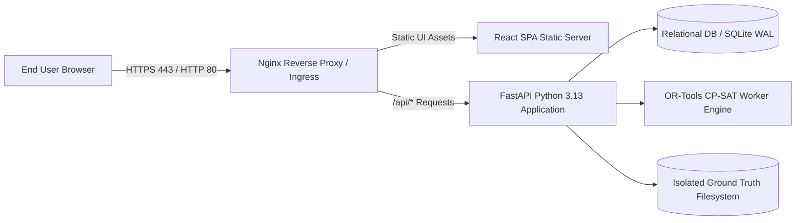

# Deployment, Operations & Production Readiness Guide
## Intelligent Workforce Scheduling & Optimization Platform

**Document Version:** 1.0.0  
**Target Environments:** Local Containerized / Enterprise Cloud (Docker, Kubernetes)  

---

## 1. Deployment Topology

The platform is packaged into two container services with persistent volume storage:
1. **`workforce-backend`:** FastAPI ASGI application serving REST APIs and hosting the Google OR-Tools CP-SAT solver engine.
2. **`workforce-frontend`:** Nginx web server serving compiled React 19 SPA static assets and reverse-proxying `/api/` traffic to the backend.



---

## 2. Environment Variables Configuration

Create a `.env` file in the project root:

```ini
# Application Core
ENV=production
DEBUG=false
APP_NAME="Intelligent Workforce Scheduling Platform"
SECRET_KEY=e9a8f4c2d3b1085741639d48b7e21fae345b98a1234567890abcdef123456789
ALGORITHM=HS256
ACCESS_TOKEN_EXPIRE_MINUTES=60

# Database
DATABASE_URL=sqlite:///./workforce.db
# For PostgreSQL: postgresql+psycopg2://user:pass@db:5432/workforce_platform

# Scheduling Solver Defaults
SOLVER_DEFAULT_TIMEOUT_SECONDS=30
SOLVER_MAX_SEARCH_WORKERS=8
SOLVER_DEFAULT_SEED=20261022

# Synthetic Data Engine
DATASET_DEFAULT_SEED=20261022
DATASET_STORAGE_PATH=./datasets
GROUND_TRUTH_STORAGE_PATH=./datasets/ground_truth

# CORS
ALLOWED_ORIGINS=http://localhost:5173,http://localhost:3000,http://127.0.0.1:8000
```

---

## 3. Dockerfile & Docker Compose Reference

### Docker Compose (`docker-compose.yml`)
```yaml
version: '3.8'

services:
  backend:
    build:
      context: .
      dockerfile: backend/Dockerfile
    container_name: workforce_backend
    restart: always
    ports:
      - "8000:8000"
    environment:
      - DATABASE_URL=sqlite:///./data/workforce.db
      - SOLVER_DEFAULT_TIMEOUT_SECONDS=30
    volumes:
      - backend_data:/app/data
      - datasets_vault:/app/datasets
    healthcheck:
      test: ["CMD", "curl", "-f", "http://localhost:8000/api/v1/health"]
      interval: 15s
      timeout: 5s
      retries: 3

  frontend:
    build:
      context: ./frontend
      dockerfile: Dockerfile
    container_name: workforce_frontend
    restart: always
    ports:
      - "80:80"
    depends_on:
      - backend

volumes:
  backend_data:
  datasets_vault:
```

---

## 4. Health Check & Observability Endpoints

- **Liveness Probe:** `GET /api/v1/health/liveness` -> `{"status": "alive"}`
- **Readiness Probe:** `GET /api/v1/health/readiness` -> Verifies database connectivity and solver engine availability.
- **Metrics Telemetry:** `GET /api/v1/health/metrics` -> Solver execution times, active jobs, memory usage.

